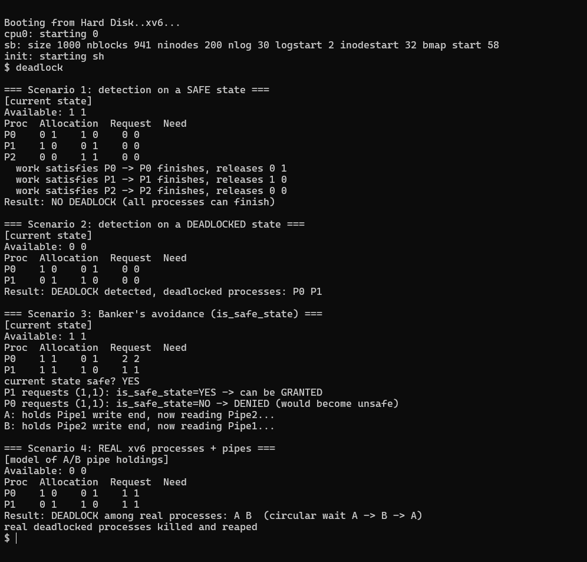

# xv6 Deadlock — Detection & Banker's Avoidance Algorithm

**Course:** MA3104 — Operating Systems Lab  
**Assignment:** 07 | **Module:** Deadlock Detection & Avoidance

---

## Overview

This module implements and demonstrates both **deadlock detection** (Resource-Allocation Graph / matrix algorithm) and **deadlock avoidance** (Banker's Algorithm) inside xv6. It runs entirely as a user-space program (`deadlock`) on top of the standard xv6 kernel — no kernel modifications are required.

Four scenarios are exercised:

| Scenario | Description |
|----------|-------------|
| 1 | Detection on a **safe state** — no deadlock found |
| 2 | Detection on an explicitly **deadlocked state** |
| 3 | Banker's **avoidance** — safe-state check before granting a request |
| 4 | **Real xv6 processes + pipes** — genuine circular wait, then kill/reap |

---

## Files

| File | Role |
|------|------|
| `deadlock.c` | All algorithm logic and scenario drivers — self-contained user program |
| `Makefile` | Build system (QEMU target) |

---

## Algorithm Details

### Data Structures (up to 5 processes × 3 resource types)

```
Allocation[i][j]  — resources of type j currently held by process i
Request[i][j]     — resources of type j process i is still waiting for
Max[i][j]         — maximum demand of process i for resource type j
Available[j]      — free instances of resource type j
Need[i][j]        — Max[i][j] - Allocation[i][j]
```

### Deadlock Detection (`detect_deadlock`)

Implements the **resource-allocation graph reduction** algorithm:

1. Start with `work[] = Available[]`; mark all processes unfinished.
2. Repeatedly find an unfinished process `i` whose `Request[i] <= work[]` (can be satisfied).
3. Pretend `i` finishes: add `Allocation[i]` back to `work`, mark `i` finished.
4. Repeat until no more processes can finish.
5. Any remaining **unfinished** processes are in a **deadlock cycle**.

### Banker's Safety Check (`safety_check`)

Identical structure to detection but uses `Need[]` instead of `Request[]`. Returns `1` if a safe sequence exists, `0` if the state is unsafe.

### Banker's Avoidance (`is_safe_state`)

Before granting a request `req[]` from process `pid`:
1. Verify `req[i] <= Need[pid][i]` and `req[i] <= Available[i]` (sanity check).
2. **Tentatively** apply the grant: decrement `Available`, increment `Allocation[pid]`.
3. Run `safety_check()` on the resulting hypothetical state.
4. **Roll back** the grant.
5. Return `1` (safe → can grant) or `0` (unsafe → deny).

---

## Scenario Walkthrough

### Scenario 1 — Safe State (No Deadlock)

```
Processes: P0, P1, P2   Resources: R0, R1
Available: [1, 1]
Allocation: P0=[0,1]  P1=[1,0]  P2=[0,0]
Request:    P0=[1,0]  P1=[0,1]  P2=[1,1]
```

Work can satisfy P0 (Request=[1,0] <= [1,1]) → P0 finishes, work=[1,2].  
Then P1 (Request=[0,1] <= [1,2]) → P1 finishes; then P2.  
**Result: NO DEADLOCK**

### Scenario 2 — Deadlocked State

```
Processes: P0, P1   Resources: R0, R1
Available: [0, 0]
Allocation: P0=[1,0]  P1=[0,1]
Request:    P0=[0,1]  P1=[1,0]
```

P0 needs R1 (held by P1). P1 needs R0 (held by P0). Neither can proceed.  
**Result: DEADLOCK detected — P0, P1**

### Scenario 3 — Banker's Avoidance

```
Available: [1,1]
Allocation: P0=[1,1]  P1=[1,1]
Max:        P0=[3,3]  P1=[2,2]
Need:       P0=[2,2]  P1=[1,1]
```

Current state is **safe** (P1 can finish first, releasing [1,1]; then P0 gets [2,2]).

- **P1 requests (1,1)**: would leave Available=[0,0]; P1's Need=[0,0] → P1 finishes, P0 gets [1,1] → **safe → GRANTED**.
- **P0 requests (1,1)**: would leave Available=[0,0]; P0's Need=[1,1] > [0,0] → P1 can't finish either → **unsafe → DENIED**.

### Scenario 4 — Real xv6 Circular Wait

Two real xv6 processes are forked with pipes:
- **Process A** holds the write-end of Pipe1, blocks reading Pipe2.
- **Process B** holds the write-end of Pipe2, blocks reading Pipe1.

This creates a genuine **circular wait** (`A → B → A`). The matrix model detects the deadlock, then the parent issues `kill()` on both blocked children to resolve it.

```
Result: DEADLOCK among real processes: A B (circular wait A -> B -> A)
real deadlocked processes killed and reaped
```

---

## Result



The screenshot above shows the xv6 QEMU output of running `deadlock`. Note:
- Scenario 1 correctly reports **NO DEADLOCK**.
- Scenario 2 identifies the deadlocked processes.
- Scenario 3 shows Banker's avoidance accepting one request and denying another.
- Scenario 4 demonstrates detection on real, live blocked xv6 processes.

---

## Key Concepts Demonstrated

- **Necessary conditions** for deadlock: mutual exclusion, hold-and-wait, no preemption, circular wait.
- **Detection algorithm** — post-facto identification using resource matrix reduction.
- **Banker's Algorithm** — proactive avoidance by maintaining a safe state.
- **Practical deadlock resolution** — killing processes to break a circular wait.

---

## Building & Running

```bash
# From the oslab7/deadlock directory (Linux/WSL with QEMU)
make qemu-nox
# Inside xv6 shell:
$ deadlock
```
