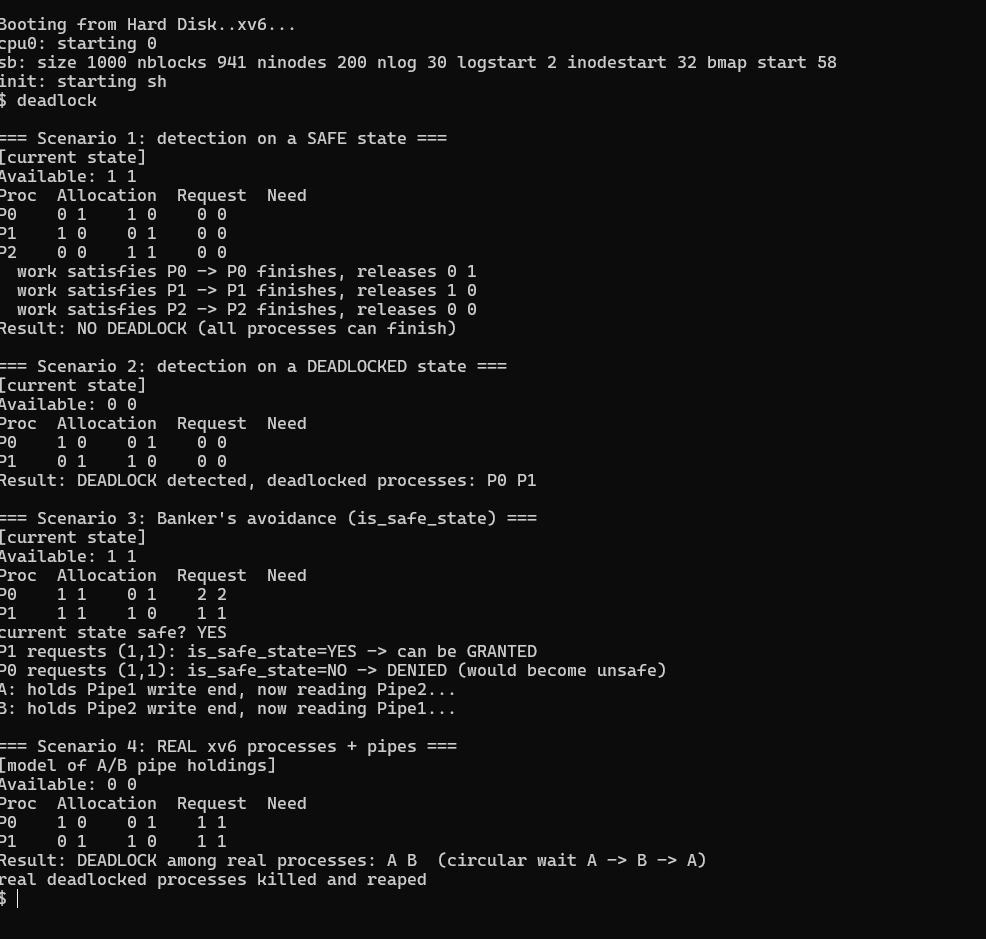

# xv6 Priority Scheduling — Priority-Based Scheduler with Aging

**Course:** MA3104 — Operating Systems Lab  
**Assignment:** 07 | **Module:** CPU Scheduling

---

## Overview

This module replaces xv6's default **round-robin** scheduler with a **priority-based scheduler** that incorporates **aging** to prevent starvation. Two new system calls expose priority management to user space:

| System Call | Signature | Description |
|-------------|-----------|-------------|
| `set_priority` | `int set_priority(int pid, int priority)` | Set the scheduling priority of process `pid` (higher value = higher priority) |
| `get_priority` | `int get_priority(int pid)` | Return the current priority of process `pid` |

---

## Files

| File | Role |
|------|------|
| `proc.c` | Modified `scheduler()` loop with priority selection and aging logic |
| `proc.h` | `struct proc` extended with `priority` and `ticks_waiting` fields |
| `sysproc.c` | Syscall wrappers: `sys_set_priority`, `sys_get_priority` |
| `syscall.c` / `syscall.h` | Dispatch table entries for the new syscalls |
| `user.h` / `usys.S` | User-space prototypes and `SYSCALL` entries |
| `priotest.c` | Test program — four processes with different priorities running CPU-bound loops |
| `Makefile` | Build system (QEMU target) |

---

## Scheduler Design

### Priority Selection
On each scheduling tick the kernel scans `ptable` for all `RUNNABLE` processes and picks the one with the **highest `priority` value**. The selected process runs for one time quantum (one timer interrupt).

```c
// Pseudo-code of the modified scheduler loop
struct proc *chosen = 0;
for each p in ptable where p->state == RUNNABLE:
    if chosen == 0 || p->priority > chosen->priority:
        chosen = p;
run(chosen);
```

### Aging (Starvation Prevention)
Every scheduling pass, all `RUNNABLE` processes that were **not** selected have their `ticks_waiting` incremented. Once `ticks_waiting` crosses a threshold (e.g. 50 ticks), the process's `priority` is boosted by 1 and `ticks_waiting` resets. This prevents low-priority processes from waiting indefinitely.

```
Every tick for non-selected RUNNABLE processes:
    p->ticks_waiting++
    if p->ticks_waiting >= AGING_THRESHOLD:
        p->priority++
        p->ticks_waiting = 0
```

---

## Test Program — `priotest.c`

```c
int prios[4] = {1, 5, 10, 20};

for (int i = 0; i < 4; i++) {
    if (fork() == 0)
        child(i, prios[i]);   // sets priority then spins for 100 ticks
}
```

Four child processes are forked, each assigned a distinct priority (`1`, `5`, `10`, `20`). Every child runs a CPU-bound spin loop for **100 scheduler ticks** and prints its progress every 20 ticks.

### Expected Behavior

- **proc 3 (prio 20)** gets the most CPU time early on — it finishes first.
- **proc 2 (prio 10)** runs next most frequently.
- **proc 1 (prio 5)** runs after higher-priority processes yield.
- **proc 0 (prio 1)** has the least initial priority but **aging** gradually boosts its priority, preventing starvation — it still completes.

Sample output:
```
proc 3 pid 7 START prio 20 tick 12
proc 2 pid 6 START prio 10 tick 13
proc 1 pid 5 START prio 5  tick 14
proc 0 pid 4 START prio 1  tick 15
proc 3 pid 7 tick 32 priority 20
proc 3 pid 7 FINISHED tick 112 priority 20
proc 2 pid 6 FINISHED tick 142 priority 10
proc 1 pid 5 FINISHED tick 192 priority 5
proc 0 pid 4 FINISHED tick 272 priority 3   ← aging raised prio from 1
all 4 completed - order follows priority; pid with prio 20 survived via aging
```

---

## Result



The screenshot above shows the xv6 QEMU output of running `priotest`. Observe:
- Processes finish in **descending priority order** (20 → 10 → 5 → 1).
- The lowest-priority process (prio 1) **still completes** thanks to aging, which gradually elevates its priority.
- Progress printouts confirm each process gets proportionally fewer CPU ticks early on.

---

## Key Concepts Demonstrated

- **Preemptive priority scheduling** — higher-priority processes preempt lower-priority ones at every tick.
- **Priority inversion risk** — low-priority processes may be starved without aging.
- **Aging / dynamic priority boost** — a practical starvation-prevention technique used in real OSes (e.g., Linux's CFS, Windows scheduler).
- Modifying xv6's `scheduler()` function without breaking existing process management.

---

## Building & Running

```bash
# From the oslab7/scheduling directory (Linux/WSL with QEMU)
make qemu-nox
# Inside xv6 shell:
$ priotest
```
