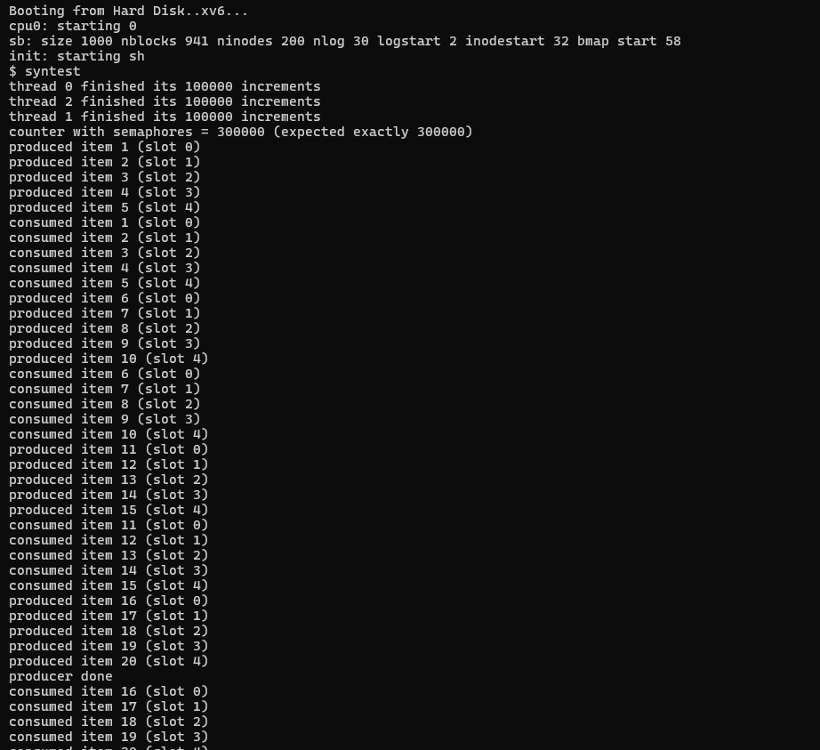

# xv6 Semaphore Implementation — Kernel Semaphores & Synchronization

**Course:** MA3104 — Operating Systems Lab  
**Assignment:** 07 | **Module:** Semaphore & Synchronization

---

## Overview

This module extends xv6 with **kernel-managed counting semaphores** and uses them to demonstrate two classic synchronization problems:

1. **Mutual exclusion** — protecting a shared counter from race conditions.
2. **Producer-Consumer** (Bounded-Buffer) — coordinating a producer and consumer thread via semaphore signals.

Three new system calls are added:

| System Call | Signature | Description |
|-------------|-----------|-------------|
| `sem_init`  | `int sem_init(int id, int value)` | Initialise semaphore `id` with an initial count of `value` |
| `sem_wait`  | `int sem_wait(int id)` | Decrement (P / down); blocks the calling thread if count reaches 0 |
| `sem_signal`| `int sem_signal(int id)` | Increment (V / up); wakes one blocked thread if count was 0 |

The `clone` / `join` system calls (from the `thread` module) are also included here to support user-level threads.

---

## Files

| File | Role |
|------|------|
| `proc.c` | Kernel implementation of `clone`, `join`, `sem_init`, `sem_wait`, `sem_signal` |
| `proc.h` | `struct proc` extended with thread fields; global semaphore table |
| `sysproc.c` | Syscall wrappers: `sys_sem_init`, `sys_sem_wait`, `sys_sem_signal`, `sys_clone`, `sys_join` |
| `syscall.c` / `syscall.h` | Dispatch table entries for all new syscalls |
| `user.h` / `usys.S` | User-space prototypes and `SYSCALL` entries |
| `syntest.c` | Test program — mutual exclusion counter + producer-consumer |
| `Makefile` | Build system (QEMU target) |

---

## Semaphore Design

Semaphores are stored in a fixed global array inside the kernel (indexed by `id`, 0–N). Each entry holds:
- `int count` — the current semaphore value.
- A **sleep channel** — threads blocked on `sem_wait` sleep on `&sem[id]`; `sem_signal` wakes them via `wakeup()`.

**`sem_wait(id)`** — atomically decrements `count`; if it would go negative the thread calls `sleep()` (releasing `ptable.lock` atomically) until signalled.

**`sem_signal(id)`** — increments `count` and calls `wakeup(&sem[id])` to resume one waiting thread.

All operations run with `ptable.lock` held to avoid TOCTOU races.

---

## Test Program — `syntest.c`

### Part 1: Mutual Exclusion Counter

```c
#define NTHREADS 3
#define INCS     100000
#define SEM_COUNTER 0

static int counter = 0;

void worker(void *arg) {
    for (int i = 0; i < INCS; i++) {
        sem_wait(SEM_COUNTER);   // entry section (P)
        counter++;               // critical section
        sem_signal(SEM_COUNTER); // exit section (V)
    }
    exit();
}
// sem_init(SEM_COUNTER, 1);  — binary semaphore (mutex)
```

Three threads each do 100,000 protected increments. Because the semaphore enforces mutual exclusion, **no updates are lost**.

Expected output:
```
thread 0 finished its 100000 increments
thread 1 finished its 100000 increments
thread 2 finished its 100000 increments
counter with semaphores = 300000 (expected exactly 300000)
```

### Part 2: Producer-Consumer (Bounded Buffer)

```
SEM_EMPTY = BUFSZ (5)   — slots available for producer
SEM_FULL  = 0           — items available for consumer
SEM_BUF   = 1           — mutex on buffer index update
```

The producer calls `sem_wait(EMPTY)` before writing and `sem_signal(FULL)` after. The consumer does the reverse. `SEM_BUF` protects the `inpos`/`outpos` pointers. This guarantees:
- No buffer overflow (producer blocks when full).
- No buffer underflow (consumer blocks when empty).
- No concurrent index corruption.

Expected output:
```
produced item 1 (slot 0)
consumed item 1 (slot 0)
produced item 2 (slot 1)
...
producer-consumer completed with no overflow/underflow
```

---

## Result



The screenshot above shows the xv6 QEMU output of running `syntest`. Note:
- The semaphore-protected counter reaches **exactly 300,000** (compare with the unsynchronized `threadtest` result).
- Every produced item is consumed exactly once, in order, with no overflow or underflow.

---

## Key Concepts Demonstrated

- **Counting semaphores** as a general-purpose synchronization primitive.
- **Binary semaphore** (initialised to 1) acting as a **mutex**.
- **Condition synchronization** — using two semaphores (`EMPTY` + `FULL`) to implement bounded-buffer producer-consumer.
- `sleep()` / `wakeup()` inside the kernel as the building block for blocking.

---

## Building & Running

```bash
# From the oslab7/semaphore directory (Linux/WSL with QEMU)
make qemu-nox
# Inside xv6 shell:
$ syntest
```
