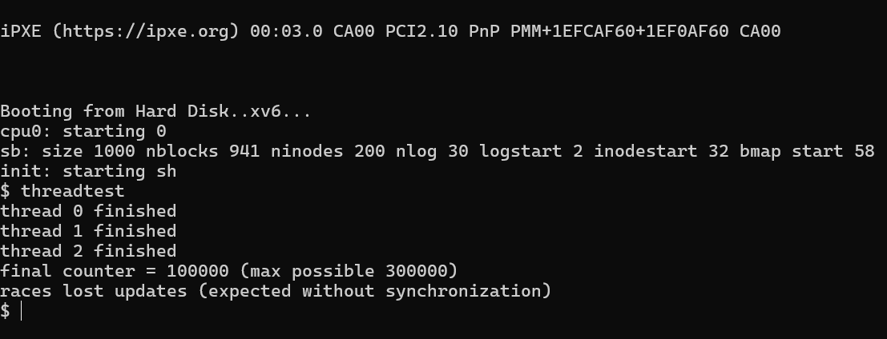

# xv6 Thread Implementation — `clone` & `join` System Calls

**Course:** MA3104 — Operating Systems Lab  
**Assignment:** 07 | **Module:** Thread Support

---

## Overview

This module adds **user-level thread support** to xv6 by implementing two new system calls:

| System Call | Signature | Description |
|-------------|-----------|-------------|
| `clone`     | `int clone(void(*fcn)(void*), void *arg, void *stack)` | Creates a new thread sharing the parent's address space |
| `join`      | `int join(void)` | Waits for any child thread to finish; returns its stack pointer |

Threads created via `clone` share the **same page table / virtual address space** as the parent process. Each thread gets its own kernel stack but reads and writes the same global variables.

---

## Files

| File | Role |
|------|------|
| `proc.c` | Kernel implementation of `clone()` and `join()` in the process table |
| `proc.h` | `struct proc` extended to carry `isthread` and `ustack` fields |
| `sysproc.c` | Thin syscall wrappers: `sys_clone`, `sys_join` |
| `syscall.c` / `syscall.h` | Dispatch table entries for the new syscalls |
| `user.h` / `usys.S` | User-space prototypes and `SYSCALL` macro entries |
| `threadtest.c` | Test program demonstrating race conditions without synchronization |
| `Makefile` | Build system (QEMU target) |

---

## How It Works

### `clone()` — Kernel Side
1. Allocates a new `struct proc` entry in `ptable`.
2. **Copies the parent's page table** (via `copyuvm`) but maps the provided `stack` page as the new thread's user stack at the same virtual address — so heap and globals are shared.
3. Sets up the new thread's trap frame to begin execution at `fcn(arg)`.
4. Marks `p->isthread = 1` so `join()` can distinguish threads from forked children.

### `join()` — Kernel Side
1. Scans `ptable` for a `ZOMBIE` entry with `isthread == 1` that belongs to the calling process.
2. Frees the kernel stack and `struct proc`; returns the saved `ustack` address to the caller (so the caller can `free()` the stack memory).

---

## Test Program — `threadtest.c`

```c
#define NTHREADS 3
#define INCS     100000

static int counter = 0;   // shared across all threads

void worker(void *arg) {
    for (int i = 0; i < INCS; i++) {
        if (i % 1000 == 0) {
            int v = counter;  // READ
            sleep(1);         // preempted here — stale value in v
            counter = v + 1;  // WRITE stale -> lost update
        } else {
            counter++;        // non-atomic RMW
        }
    }
    exit();
}
```

Three threads each attempt **100,000 increments** of a shared counter **without any synchronization**. The deliberate `sleep(1)` between read and write maximises the race window.

### Expected Outcome

```
thread 0 finished
thread 1 finished
thread 2 finished
final counter = <N>  (max possible 300000)
races lost updates (expected without synchronization)
```

Because increments are non-atomic, the final value is **less than 300,000** — demonstrating the classic **lost-update** race condition. This motivates the need for mutexes / semaphores (see the `semaphore/` module).

---

## Result



The screenshot above shows the xv6 QEMU output of running `threadtest`. Observe:
- All three threads start and finish.
- The reported `final counter` is **significantly below** the maximum of `300,000`.
- The last line confirms race-induced lost updates.

---

## Key Concepts Demonstrated

- **Shared address space threads** vs. `fork()`-style process isolation.
- **Race conditions** arising from non-atomic read-modify-write operations on shared data.
- **Context switching** between threads using xv6's existing scheduler without modification.
- The necessity of synchronization primitives to achieve correctness.

---

## Building & Running

```bash
# From the oslab7/thread directory (inside a Linux/WSL environment with QEMU)
make qemu-nox
# Inside xv6 shell:
$ threadtest
```
